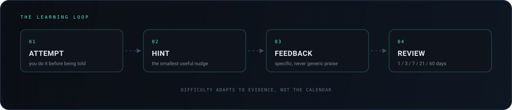
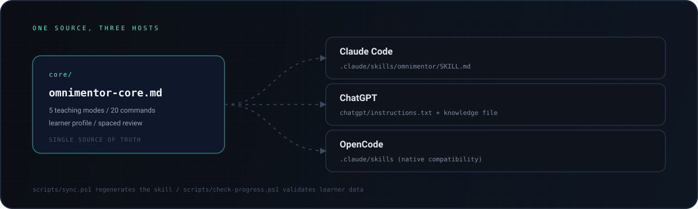

<div align="center">
  
</div>

<br />

<p align="center">
  <a href="LICENSE"></a>
  
  
  
</p>

<h1 align="center">OmniMentor</h1>

<p align="center">
  <b>The mentor that makes you do the work.</b><br />
  One adaptive mentor for every skill. Practice first. Evidence over vibes.<br />
  <sub>Claude Code &nbsp;/&nbsp; ChatGPT &nbsp;/&nbsp; OpenCode &nbsp;·&nbsp; MIT</sub>
</p>

<p align="center">
  <a href="#watch-it-teach">Demo</a> &nbsp;/&nbsp;
  <a href="#install">Install</a> &nbsp;/&nbsp;
  <a href="#how-it-works">How it works</a> &nbsp;/&nbsp;
  <a href="#memory">Memory</a> &nbsp;/&nbsp;
  <a href="#commands">Commands</a> &nbsp;/&nbsp;
  <a href="#faq">FAQ</a>
</p>

---

## Watch it teach

<div align="center">
  
</div>

A 30-second walkthrough of the loop: a task, a real mistake, a hint that does not give the answer, a fix, and the evidence written to your profile.

Want the full recording? [`demo/SCRIPT.md`](demo/SCRIPT.md) is the shot list, and [`demo/run-demo.ps1`](demo/run-demo.ps1) resets the stage in one command.

## The problem

| | Typical AI chat | Typical course | OmniMentor |
|---|---|---|---|
| When you ask | You get an answer | You follow a syllabus | You get a task |
| Difficulty | Resets every chat | Fixed for everyone | Calibrated to evidence |
| Progress | Not tracked | Lessons completed | Capability demonstrated |
| After the session | Nothing persists | Next video | Weak spots return on schedule |

Answers feel productive and disappear. Courses are structured and inflexible. OmniMentor keeps the structure and drops the script.

## What you get

- **One learning controller** that decides the next task from evidence, not from a menu.
- **Five teaching modes** that change the method, not just the topic.
- **Twenty commands** for learning, practice, assessment, debugging, interviews, and planning.
- **A persistent learner profile** with mastery, proof, confidence, prerequisites, misconceptions, and review dates.
- **Adaptive roadmaps** that compress, repair, or reorder phases from checkpoints.
- **Three hosts** from one shared spec: Claude Code, ChatGPT, and OpenCode.

## How it works

Every non-transactional turn runs the same loop:

1. **Locate** — read the learner profile, or run a short cold-start diagnostic when there is none.
2. **Target** — pick the weakest blocking skill. An explicit request wins unless a blocking prerequisite is missing.
3. **Task** — one small, checkable task. The confidence rating is part of the instruction, not a separate question.
4. **Evaluate** — correctness, reasoning, independence, misconception, transfer.
5. **Feedback** — nudge → error location → smaller sub-problem → worked solution. The full solution comes only after two genuine attempts.
6. **Write** — the ledger is updated in the same reply. Not writing is a failure state.
7. **Next** — the next action comes from the new evidence.

<div align="center">
  
</div>

### Five modes, one standard

| Mode | Applies to | Method |
|---|---|---|
| Programming | Languages and frameworks | Build first; spec, not finished code; review as Working / Fragile / Improve; every assessment labeled `Executed` or `Static` |
| DSA | Algorithms and data structures | Pattern discovery, never a spoiler; the same pattern disguised differently |
| System Design | Architecture | Scenario first, then scale and failure constraints, then trade-offs |
| Theory | Concepts | Short explanation, immediate quiz, a different analogy on a miss |
| General Skill | Everything else | The smallest real unit of practice, done now, with specific feedback |

A topic plus a timeframe triggers **Adaptive Timeline Planning** instead: a phase table, weekly rhythm, and checkpoints you can verify by doing.

## Memory

Where the host can write files, OmniMentor keeps a learner profile at `.omnimentor/progress.md` (git-ignored). Three sections: the active plan, the last session, and a mastery table.

| Topic | Subtopic / pattern | Status | Proof | Last evidence | Interval (days) | Next review | Gap notes |
|---|---|---|---|---|---|---|---|
| DSA | sliding window | learning | hinted | 2026-11-06 | 1 | 2026-11-07 | window shrink off-by-one |

Three optional columns — `Prereq`, `Confidence`, `Misconception` — extend the same table. Existing 8-column files stay valid.

- **Proof** separates knowing from copying: `independent` (no hint, no solution seen), `hinted` (after help), `solution` (revealed, copied, or cannot explain how they got it).
- **Mastery is a gate, not a vibe.** `mastered` requires an independent pass, an explanation in your own words, and an independent transfer pass.
- **Confidence is recorded**, but it never promotes on its own. Confident and wrong is the top priority; correct but unsure gets one more independent item.
- **Spacing follows evidence:** 1 → 3 → 7 → 21 → 60 days. A hint, a copy, or a miss resets to 1.
- **One row per topic and subtopic**, updated in place. Duplicates are merged, never accumulated.
- **The write is mandatory** on every assessed turn, before the next action.

Validate a profile with:

```powershell
powershell -File scripts/check-progress.ps1
powershell -File scripts/check-progress.ps1 -SelfTest
```

```text
SELFTEST PASS: 8-col clean; 11-col clean incl. missing confidence; bad 11-col caught 6; mixed header rejected
```

## Roadmaps that move

A plan is not a calendar. At every checkpoint, OmniMentor adjusts from evidence:

- **Passed** — compress the next phase and keep its milestone.
- **Blocking prerequisite missing** — insert a repair block before the dependent phase.
- **Non-blocking gap** — postpone that topic only; do not stall the plan.
- **Wrong depth** — change the phase's focus and rewrite the milestone.

Every change is logged in the active plan. Structural changes reprint the phase table; a date shift gets one line.

## One source, three hosts

<div align="center">
  
</div>

| Host | Form | Persistent profile |
|---|---|---|
| Claude Code | `.claude/skills/omnimentor` skill | Yes, file-based |
| ChatGPT | Custom GPT, brief + knowledge file | No, paste the profile |
| OpenCode | `.claude/skills` compatibility | Yes, file-based |

## Install

### Claude Code

```bash
git clone https://github.com/Merged-PRs/OmniMentor.git
cd OmniMentor
cp -r .claude/skills/omnimentor ~/.claude/skills/omnimentor
```

```text
/omnimentor learn rust
```

`/omnimentor` is the registered command. The `/learn`, `/dsa`, and `/timeline` tokens are conventions the loaded skill interprets; a bare `/learn` will not reach the model.

### OpenCode

No extra files. OpenCode 2.x discovers `.claude/skills` as a documented compatibility source:

```bash
cd OmniMentor
opencode
```

```text
@omnimentor /learn rust
```

For a global install, copy the skill to `~/.claude/skills/omnimentor` (shared with Claude Code) or `~/.config/opencode/skills/omnimentor` (OpenCode only; higher precedence).

### ChatGPT

1. **Explore GPTs → Create** → **Configure**.
2. Paste [`chatgpt/instructions.txt`](chatgpt/instructions.txt) into **Instructions**.
3. Upload [`core/omnimentor-core.md`](core/omnimentor-core.md) as **Knowledge**.
4. Turn **Code Interpreter & Data Analysis** on, so it can run your code.

Full walkthrough: [`chatgpt/SETUP.md`](chatgpt/SETUP.md).

## Commands

| Group | Commands | Notes |
|---|---|---|
| Learn and plan | `/learn` `/timeline` `/roadmap` | Controller, then a plan |
| Force a mode | `/program` `/dsa` `/design` `/theory` | Same loop, fixed method |
| Practice and test | `/quiz` `/practice` `/challenge` `/mock` `/recap` `/progress` | Graded, written to the profile |
| Code help | `/debug` `/review` | Guiding questions, then evidence |
| Explain | `/explain` `/eli5` | Three depths, zero jargon |
| Adjust | `/harder` `/easier` | Re-run the last item |
| Build | `/project` | Milestones, built with you |

`/quiz` and `/recap` are controller task types; they do not bypass the ledger write.

## FAQ

**Do I need an API key?**
No. OmniMentor runs inside a host you already use; model usage is billed by that host.

**Does it remember me between chats?**
Where the host can write files (Claude Code, OpenCode), yes, through `.omnimentor/progress.md`. In a Custom GPT or plain chat, paste the profile in and ask for an updated copy.

**Can I use it for non-technical skills?**
Yes. General Skill Mode covers writing, speaking, interviews, research, and other practice-based skills.

**Can I change how it teaches?**
Yes. Edit `core/omnimentor-core.md`, run `scripts/sync.ps1`, and update the ChatGPT brief if a rule or command changed. The spec is the only place behavior lives.

**Which host should I use?**
Claude Code or OpenCode for file-based memory. ChatGPT for a portable GPT. The teaching behavior is identical.

## Limitations

- **No memory on chat-only hosts.** A Custom GPT cannot write the profile; paste it in and save the updated copy.
- **Code review is static unless the host can execute.** Where a runtime exists, OmniMentor runs the code and labels it `Executed`; otherwise `Static`.
- **Commands are conventions.** Only `/omnimentor` (Claude Code) and `@omnimentor` (OpenCode) are host-level entry points.
- **ChatGPT has an 8,000-character instruction cap.** The brief plus the knowledge file is the supported split.
- **Model quality still matters.** The ledger can be well-formed while a model misgrades an answer; the evaluation harness under `evals/` exists to catch that.

## Development

```powershell
powershell -File scripts/sync.ps1
powershell -File scripts/check-progress.ps1 -SelfTest
powershell -File evals/run-baseline.ps1 -Runs 3
```

`core/omnimentor-core.md` is the only behavior source. `evals/` holds the scenario fixtures, rubric, and per-run evidence. `demo/` holds the recording kit.

## Contributing

Edit `core/omnimentor-core.md` only, then run `scripts/sync.ps1`. Update `chatgpt/instructions.txt` if an always-on rule, mode, or command changed. Run the validator self-test before opening a pull request.

If OmniMentor helps you learn something, star the repo.

## License

[MIT](LICENSE) — Copyright (c) 2026 prem
